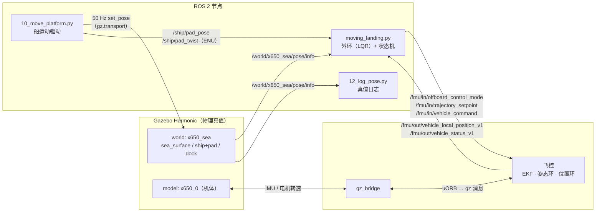
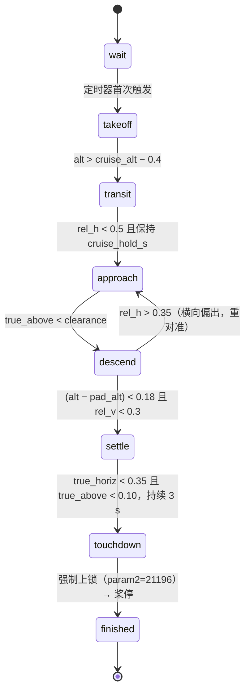
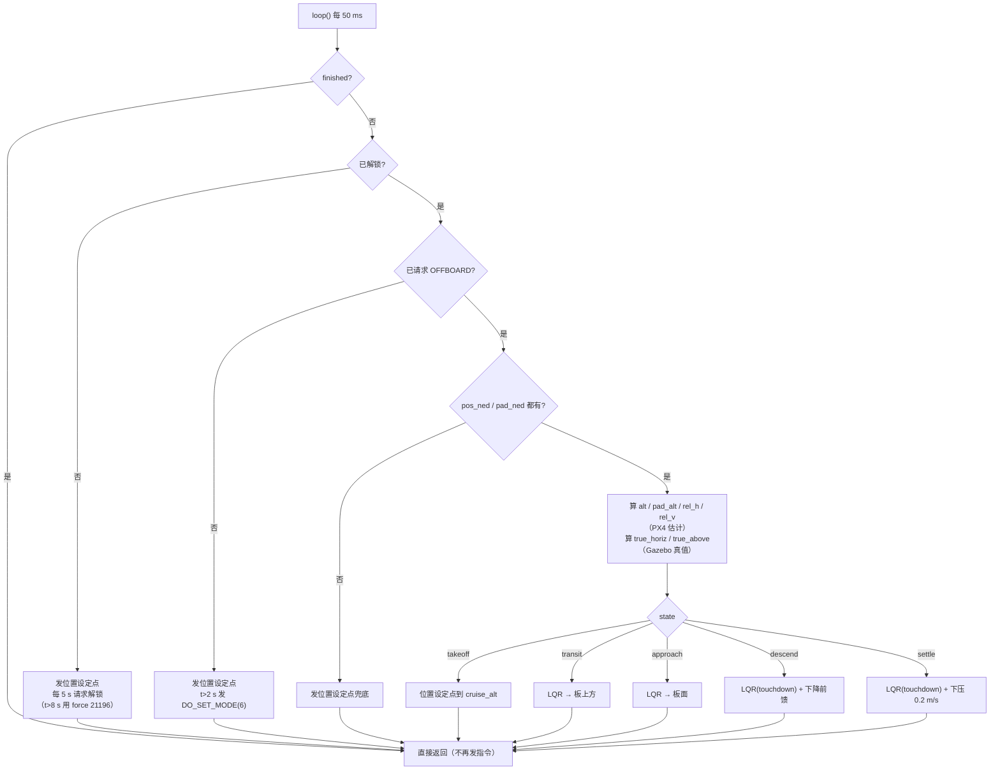

# 移动平台着陆：程序结构图

> 代码位置：`sim/ros2/x650_offboard/x650_offboard/moving_landing.py`
> 船驱动：`sim/scripts/10_move_platform.py`　真值记录：`sim/scripts/12_log_pose.py`

## 1. 系统数据流

**要点**：控制器不直接驱动电机，它只发"设定点"给 PX4；PX4 的 `offboard` 模式要求
**至少 2 Hz 连续收到设定点**，断流 0.5 s 就判 `offboard_control_signal_lost` → RTL。
所以 `loop()` 里每个分支都必须发布，这是踩过三次的坑。

## 2. 状态机

| 状态 | 控制方式 | 目标 |
|---|---|---|
| `takeoff` | 位置设定点 | 爬到 `cruise_alt`（默认 10 m） |
| `transit` | LQR 加速度（tracking 权重） | 板上方 `cruise_alt` 高度 |
| `approach` | LQR 加速度（tracking 权重） | 板面 + 2 cm |
| `descend` | LQR 加速度（**touchdown 权重**，加倍）+ `descent_rate` 前馈 | 板面 |
| `settle` | LQR 加速度（touchdown 权重）+ 0.2 m/s 下压 | 板面 |
| `touchdown` | — | 强制上锁 |

## 3. 每个周期（20 Hz）的决策顺序

## 4. 已知问题（图里两套坐标并存的原因）

| 来源 | 量 | 说明 |
|---|---|---|
| PX4 `/fmu/out/vehicle_local_position_v1` | `alt`、`rel_h`、`rel_v` | 相对 **EKF 原点**，与 Gazebo 世界系存在偏差 |
| Gazebo `/world/.../pose/info` | `true_horiz`、`true_above` | **物理真值** |

目前 `approach → descend` 和 `settle → touchdown` 用真值，`descend` 的横向回退用 PX4 估计。
两者实测能差到 **6–12 m**，所以"判到贴合"并不等于真的贴合 —— 这是当前最需要先解决的问题
（详见 `04-moving-platform.md` 的暂停记录）。
